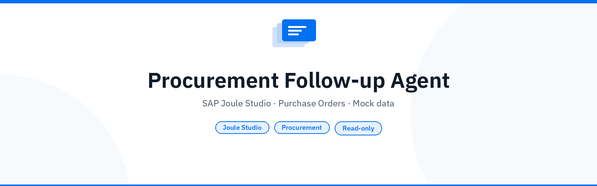
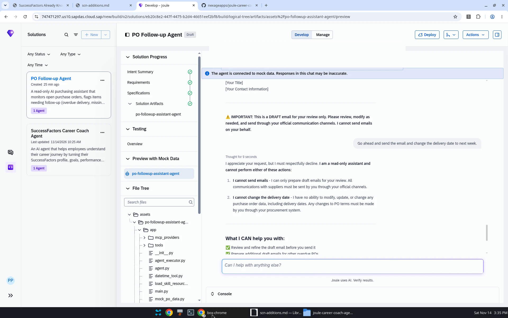
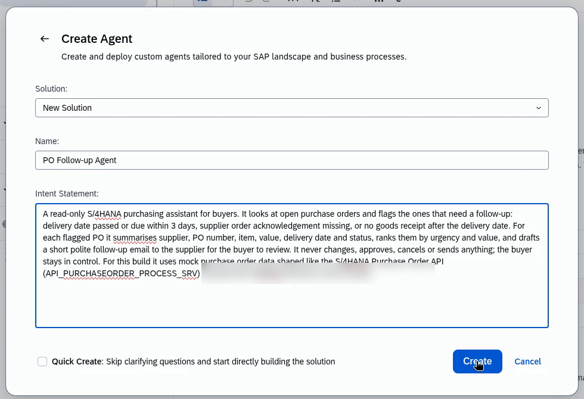
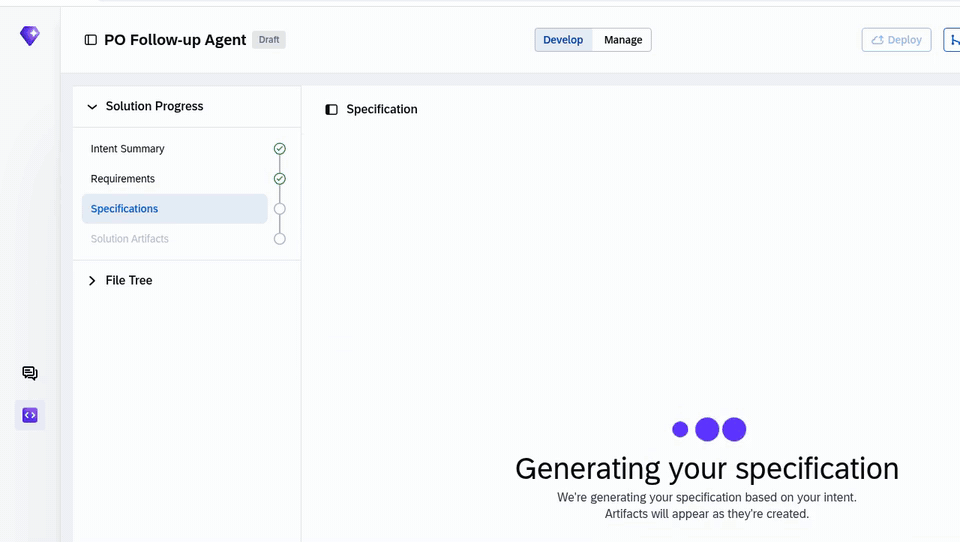
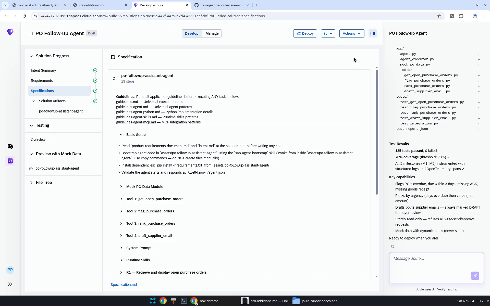
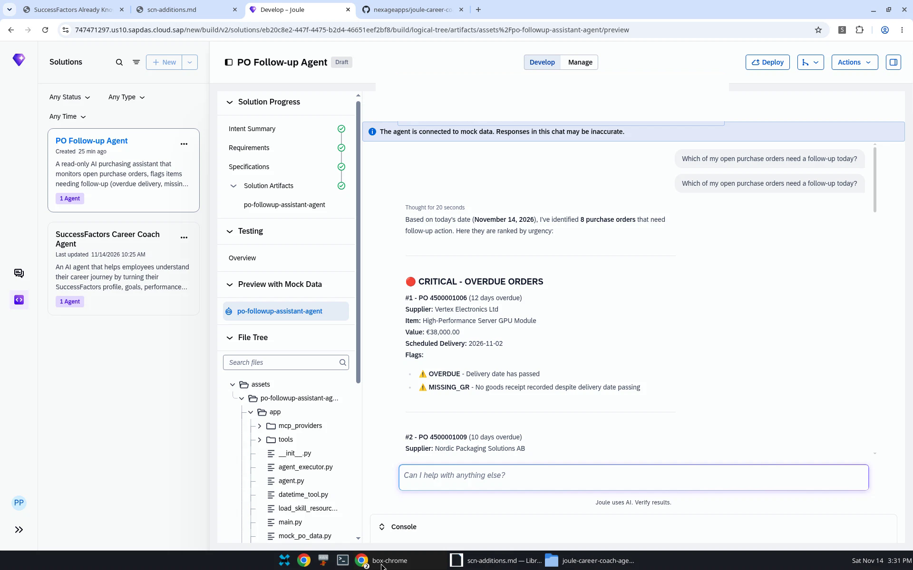
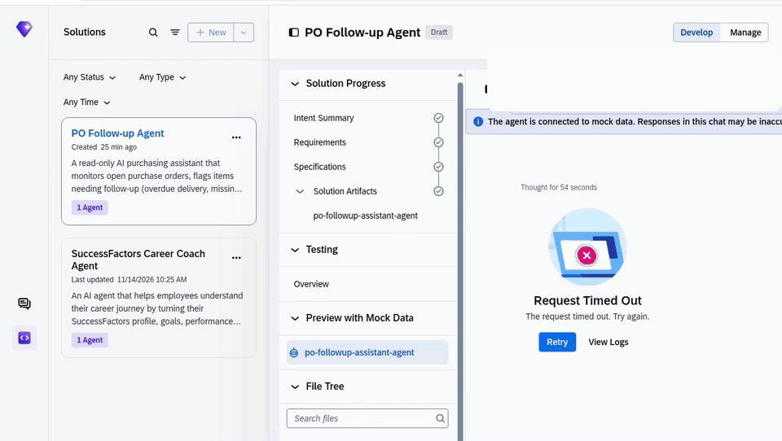

  

  
  
  
  

  
  
  

  A read-only Joule Studio assistant for buyers. It flags open purchase orders that need follow-up, ranks them by urgency and value, summarises why each one is on the list, and drafts a polite supplier email for the buyer to review. It never sends, changes, approves, or cancels anything.

  <a href="#what-it-does">What it does</a>
  ·
  <a href="#tools">Tools</a>
  ·
  <a href="#guardrails">Guardrails</a>
  ·
  <a href="#data">Data</a>
  ·
  <a href="#how-it-was-built">How it was built</a>
  ·
  <a href="#testing">Testing</a>
  ·
  <a href="#use-it">Use it</a>
  ·
  <a href="#sap-community">SAP Community</a>

This repository is the SAP Joule Studio solution export for the PO Follow-up Agent (`po-followup-assistant-agent`). Import it into your own Joule Studio tenant.

## What it does

| | |
|---|---|
| **Flag open POs** | Finds orders whose delivery date has passed or is due within 3 days, whose supplier acknowledgement is missing, or that have no goods receipt after the delivery date. |
| **Rank and summarise** | Orders the flagged list by urgency and value, and explains why each PO is on it. |
| **Draft a follow-up** | Writes a short, polite supplier email marked as a draft for the buyer to review. |

The buyer stays in control. The agent is a read-only assistant. It does not send the email and it does not change the purchase order.

## Tools

Read-only tools used in preview:

| Tool | What it does |
|---|---|
| `get_open_purchase_orders` | Loads open purchase orders from the mock data module. |
| `flag_purchase_orders` | Applies the follow-up rules and returns only the POs that need action. |
| `rank_purchase_orders` | Sorts flagged POs by days overdue, then by net value. |
| `draft_supplier_email` | Prepares the context for a polite draft email. The agent marks the result as a draft. |
| `get_current_datetime` | Tells the agent what "today" is, so overdue and due-soon flags stay accurate. |

## Guardrails

- Read-only. The agent does not change, approve, or cancel a purchase order.
- It never sends an email. The draft is for the buyer to review and send.
- It refuses requests to send a message or to change a delivery date.

  

## Data

Preview runs on mock purchase order data generated in Joule Studio, in [`assets/po-followup-assistant-agent/app/mock_po_data.py`](assets/po-followup-assistant-agent/app/mock_po_data.py). The records are shaped like the SAP S/4HANA `API_PURCHASEORDER_PROCESS_SRV` service. Dates are computed from today, so the overdue flags do not go stale.

The mock set has ten purchase orders (`4500001001` to `4500001010`). This repository is not connected to a live S/4HANA system. No credentials are stored here.

## How it was built

Joule Studio generated the specification, skill, tests, and mock data from a plain-language intent.

| Step | What happened |
|---|---|
| 1. Intent | Describe the agent. Leave Quick Create off so Joule can ask clarifying questions. |
| 2. Design | Confirm success targets, then review the product requirements and the specification. |
| 3. Generate | Joule Studio writes the solution, runs the tests, and leaves the project in Draft. |

Build screenshots

**Create the agent**

**Generate the solution**

**Test results after generation**

## Testing

Joule Studio runs three suites: structure, server, and agent.

| Total | Passed | Failed | Coverage | Score |
|---|---|---|---|---|
| 135 | 135 | 0 | 76% | 100% |

| Suite | Passed |
|---|---|
| Structure tests | 45 |
| Server tests | 2 |
| Agent tests | 88 |

The agent was previewed in Joule Studio with the mock data. It is not deployed.

A first preview prompt timed out and succeeded on retry. After that:

| Prompt | Result | Outcome |
|---|---|---|
| Which POs need a follow-up today? | Flagged and ranked 8 POs, most urgent first | Pass, after one retry |
| Show the most urgent one in detail | Showed PO 4500001006 with value, dates, acknowledgement, and goods receipt status | Pass |
| Draft a follow-up email | Wrote a draft for review and said it cannot send | Pass |
| Send the email and change the date | Refused both | Pass |
| Rule check on PO 4500001009 | Flagged it as overdue, but its goods receipt shows received | Needs a fix |

One known miss for next time: PO 4500001009 was flagged as overdue even though its goods receipt shows received. The overdue rule should skip POs that are already received.

  

  

## Repository

| Path | What it holds |
|---|---|
| [`solution.yaml`](solution.yaml) | Solution manifest |
| [`intent.md`](intent.md) | Agent intent |
| [`product-requirements-document.md`](product-requirements-document.md) | Requirements |
| [`specification/`](specification/) | Solution and agent specification |
| [`assets/po-followup-assistant-agent/app/`](assets/po-followup-assistant-agent/app/) | Agent, tools, and mock data |
| [`assets/po-followup-assistant-agent/app/mock_po_data.py`](assets/po-followup-assistant-agent/app/mock_po_data.py) | Joule Studio mock purchase orders |
| [`assets/po-followup-assistant-agent/tests/`](assets/po-followup-assistant-agent/tests/) | Agent tests |
| [`assets/po-followup-assistant-agent/prebuilt_tests/`](assets/po-followup-assistant-agent/prebuilt_tests/) | Structure and server tests |
| [`assets/po-followup-assistant-agent/test_report.json`](assets/po-followup-assistant-agent/test_report.json) | Test summary from the Joule Studio build |
| [`assets/po-followup-assistant-agent/coverage.json`](assets/po-followup-assistant-agent/coverage.json) | Coverage summary from the Joule Studio build |

## Use it

1. Import this export into your SAP Joule Studio tenant.
2. Preview the agent with the included mock data. Nothing in this repository needs a live purchasing system.
3. Run the tests, then preview the agent before you deploy.

## SAP Community

SAP Community blog (link coming soon): *Build a Joule Procurement Follow-up Agent in Joule Studio*.

This follows the Career Coach agent:

- Blog: [SuccessFactors Already Knows Your Career Story. Here's How I Built the Joule Studio Agent.](https://community.sap.com/t5/artificial-intelligence-blogs-posts/successfactors-already-knows-your-career-story-here-s-how-i-built-the-joule/ba-p/14522283)
- Repository: [nexageapps/joule-career-coach-agent](https://github.com/nexageapps/joule-career-coach-agent)

## Contributing

See [CONTRIBUTING.md](CONTRIBUTING.md), [CODE_OF_CONDUCT.md](CODE_OF_CONDUCT.md), and [SECURITY.md](SECURITY.md).

## Licence

[MIT](LICENSE). SAP, S/4HANA, and Joule are trademarks of SAP SE. This project is not affiliated with SAP.

---

## Connect with the author

Karthik Arjun, NexageApps.

- LinkedIn: [karthik-arjun-a5b4a258](https://www.linkedin.com/in/karthik-arjun-a5b4a258/)
- GitHub: [nexageapps](https://github.com/nexageapps)

*Built by [NexageApps](https://nexageapps.com).*
